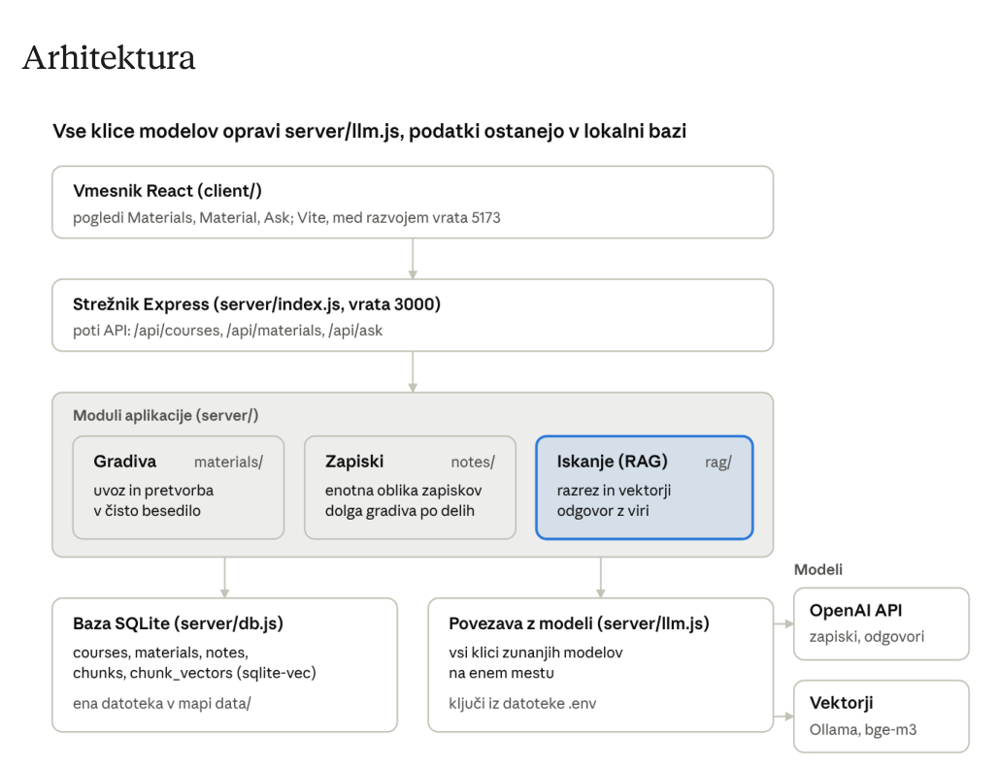

Oct 23, 2026  · @Jure
Ta dokument je samostojno navodilo za gradnjo aplikacije od prazne mape do delujoče
različice 1.0. Slediš mu lahko brez drugih virov: koraki vsebujejo ukaze, navodila za Claude
Code in merila, po katerih preveriš, da je korak končan.
## Kaj gradimo
Spletno aplikacijo za interno rabo v podjetju Abakus plus, ki iz učnih gradiv pripravi
pregledne zapiske in omogoča vprašanja o snovi vseh gradiv. Učna gradiva so transkripti
posnetih predavanj, skripte, knjige in interna gradiva podjetja. Uporabniki so zaposleni, ki
se učijo iz teh gradiv.
Aplikacijo gradimo z agentnim orodjem Claude Code, potek gradnje pa se samodejno
beleži v dnevnik razvoja (Priloga). Dnevnik je enako pomemben kot koda, ker bo
uporabljen za analizo razvoja z orodjem umetne inteligence.
## Jezik
## Funkcije različice 1.0
1. Tečaji (courses): uporabnik ustvari tečaj, ki združuje gradiva.
2. Uvoz gradiv (materials): gradivo prilepi kot besedilo ali naloži datoteko TXT, SRT ali VTT
do 5 MB. To zadostuje za knjigo do približno 800 strani besedila. Po različici 1.0 je
dodan še uvoz PDF do 30 MB (izluščeno besedilo največ 5 MB); glej »Nadgradnje po
različici 1.0«.
3. Zapiski (notes): za vsako gradivo pripravi zapiske v enotni obliki (Summary, Key points,
Terms), tudi za zelo dolga gradiva.
4. Vprašanja o snovi (RAG): uporabnik zastavi vprašanje, aplikacija poišče ustrezne
odseke v vseh gradivih in odgovori s sklicem na vir. Če odgovora v gradivih ni, to pove.
Po različici 1.0 lahko uporabnik iskanje omeji na izbrana gradiva (materialIds).
Kaj
## Jezik
Ta dokument in navodila za Claude Code v
njem
slovenščina
Koda, imena datotek, tabel, poti API,
komentarji, CLAUDE.md, dnevnik razvoja
angleščina
Uporabniški vmesnik, zapiski in odgovori
angleščina
Gradiva
angleščina; podpora za druge jezike ni
potrebna

5. Sprotno dopolnjevanje: novo gradivo je vključeno v iskanje takoj, ko je obdelano;
izbrisano gradivo se takoj odstrani.
6. Obdelava v ozadju: velika gradiva se indeksirajo in povzemajo v ozadju, vmesnik pa
prikazuje stanje obdelave.
Ni del različice 1.0: prijava uporabnikov in pravice, kvizi, uvoz datotek PDF in DOCX
(uporabnik jih lahko sam shrani kot TXT), podpora za druge jezike, samodejni prenos
transkriptov s spletnih platform, objava na javnem strežniku. Uvoz PDF je dodan kot
nadgradnja po različici 1.0; DOCX in skenirani PDF (brez besedilnega sloja) ostajata
nepodprta.
## Tehnologije
Celotna aplikacija je v JavaScriptu: strežnik v Node.js, vmesnik v Reactu. Izbira je končna,
nove odvisnosti se dodajajo samo, če jih zahteva korak v tem navodilu.
Del
Izbira
Zakaj
Urejevalnik
Visual Studio Code
z razširitvijo Claude Code vidiš
spremembe sproti
Razvojno orodje
Claude Code
piše kodo po navodilih iz tega
dokumenta
Izvajalno okolje
Node.js, trenutna LTS različica (22
ali novejša)
vgrajeno branje .env  ( --env-
file ) in testi ( node:test )
Strežnik
Express
preprost in razširjen
Nalaganje datotek
multer
sprejem datotek in dolgih besedil
v obrazcu
Vmesnik
React, ustvarjen z Vite
več pogledov in stanj (nalaganje,
obdelava, napake)
Prikaz zapiskov
react-markdown
zapiski so v obliki Markdown
Baza
SQLite prek better-sqlite3
ena datoteka, brez ločenega
strežnika
Vektorji
razširitev sqlite-vec
iskanje podobnih kosov v isti bazi
Jezikovni model
OpenAI API (ChatGPT) prek
uradnega paketa openai
zapiski in odgovori; model se
nastavi v OPENAI_MODEL
Vektorske
predstavitve
Ollama z modelom bge-m3 ,
lokalno
besedilo gradiv za iskanje ne
zapusti računalnika, brez stroškov
na klic

Za zapiske in odgovore se besedilo gradiva pošlje OpenAI API. Za interna gradiva je to
sprejemljivo le, če se s tem strinja podjetje. Aktualna imena modelov preveri na
platform.openai.com; za začetek zadošča cenejši model, ker so naloge (povzemanje,
odgovor iz odlomkov) preproste.
## Arhitektura



*Diagram extracted from the original PDF; keep `architecture.png` beside this file.*

Del
Izbira
Zakaj
Branje datotek
TXT neposredno, lastna funkcija
za SRT in VTT
brez dodatnih knjižnic
Branje PDF (nadgradnja)
unpdf
izluščenje besedila iz PDF z
besedilnim slojem
Hkratni zagon
concurrently
en ukaz zažene strežnik in
vmesnik
Testi
node:test
brez dodatnih knjižnic
Nadzor verzij
Git in zasebni repozitorij na
GitHubu
zgodovina razvoja in varnostna
kopija
arhitektura aplikacije · 4 plasti in 2 zunanji storitvi

Moduli zapiskov in iskanja (RAG) modele kličejo samo prek server/llm.js , zato je model
mogoče zamenjati na enem mestu. Med razvojem Vite na vratih 5173 posreduje klice /api
strežniku na vratih 3000. V končni različici Express streže že zgrajen vmesnik iz
client/dist , zato aplikacija teče na enem naslovu.
## Struktura projekta in podatki
Strežnik je v mapi server/ , vmesnik v mapi client/ . Korenska package.json  uporablja
ES module ( "type": "module" ). Vsa imena so angleška.
study-notes/
├─ CLAUDE.md                 navodila za Claude Code (Priloga)
├─ .claude/
│  ├─ settings.json          vklop samodejnega dnevnika (Priloga)
│  └─ hooks/devlog.cjs       skripta dnevnika (Priloga)
├─ docs/
│  ├─ spec.md                ta dokument, izvožen kot Markdown
│  └─ devlog.md              dnevnik razvoja, nastaja samodejno
├─ server/
│  ├─ index.js               Express, poti API, streženje client/dist
│  ├─ db.js                  odpiranje baze, tabele, sqlite-vec
│  ├─ llm.js                 OpenAI API in Ollama
│  ├─ jobs.js                obdelava v ozadju
│  ├─ materials/             pretvorba datotek v besedilo, shranjevanje
│  ├─ notes/                 priprava zapiskov
│  └─ rag/                   razrez, vektorji, iskanje, odgovor
├─ client/                   React + Vite
│  └─ src/
│     ├─ App.jsx             navigacija med pogledi
│     ├─ api.js              klici /api
│     ├─ views/              Materials.jsx, Material.jsx, Ask.jsx (po prenovi: pogledi)
│     ├─ components/         po prenovi vmesnika: ena komponenta na datoteko
│     └─ styles/             po prenovi vmesnika: oblikovni žetoni in slogi
├─ tests/                    testi node:test
├─ eval/                     questions.json in run.js
├─ data/                     baza app.db (v .gitignore)
├─ .env.example
├─ .gitignore
└─ package.json
## Spremenljivke okolja (`.env`, nikoli v repozitoriju)
Spremenljivka
Primer
Pomen
OPENAI_API_KEY
–
ključ za OpenAI API

## Tabele v bazi
PRAGMA foreign_keys = ON;
CREATE TABLE IF NOT EXISTS courses (
  id INTEGER PRIMARY KEY,
  name TEXT NOT NULL UNIQUE,
  created_at TEXT NOT NULL DEFAULT CURRENT_TIMESTAMP
);
CREATE TABLE IF NOT EXISTS materials (
  id INTEGER PRIMARY KEY,
  course_id INTEGER NOT NULL REFERENCES courses(id) ON DELETE CASCADE,
  title TEXT NOT NULL,
  type TEXT NOT NULL CHECK (type IN ('text','txt','srt','vtt','pdf')),
  content TEXT NOT NULL,
  status TEXT NOT NULL DEFAULT 'processing'
    CHECK (status IN ('processing','ready','error')),
  error TEXT,
  created_at TEXT NOT NULL DEFAULT CURRENT_TIMESTAMP
);
CREATE TABLE IF NOT EXISTS notes (
  id INTEGER PRIMARY KEY,
  material_id INTEGER NOT NULL UNIQUE REFERENCES materials(id) ON DELETE
CASCADE,
  content TEXT,                     -- Markdown
  model TEXT,
  status TEXT NOT NULL DEFAULT 'processing'
    CHECK (status IN ('processing','ready','error')),
  error TEXT,
  created_at TEXT NOT NULL DEFAULT CURRENT_TIMESTAMP
);
Spremenljivka
Primer
Pomen
OPENAI_MODEL
gpt-5-mini
model za zapiske in odgovore; preveri
aktualna imena
OLLAMA_URL
http://localhost:11434
naslov Ollama
EMBED_MODEL
bge-m3
model za vektorje
EMBED_DIM
1024
dolžina vektorja modela
PORT
3000
vrata strežnika
DB_PATH
data/app.db
pot do baze

CREATE TABLE IF NOT EXISTS chunks (
  id INTEGER PRIMARY KEY,
  material_id INTEGER NOT NULL REFERENCES materials(id) ON DELETE CASCADE,
  position INTEGER NOT NULL,
  text TEXT NOT NULL
);
-- one vector per chunk; rowid = chunks.id
CREATE VIRTUAL TABLE IF NOT EXISTS chunk_vectors USING vec0(embedding
float[1024]);
Virtualna tabela chunk_vectors  ne pozna tujih ključev, zato mora koda ob brisanju
gradiva vektorje njegovih kosov izbrisati sama, preden se izbrišejo kosi.
Vrednost 'pdf' v stolpcu materials.type je dodana z nadgradnjo za PDF. Ker SQLite ne
podpira spremembe omejitve CHECK, server/db.js obstoječo bazo posodobi z migracijo, ki
tabelo materials prenese v novo obliko in ohrani vse podatke.
## API
Vse poti vračajo JSON. Napake vrnejo ustrezno kodo HTTP in telo { "error": "message
in English" } .
Metoda in pot
Vhod
Izhod
GET /api/health
–
{ "ok": true }
GET /api/courses
–
seznam { id, name,
materialCount }
POST /api/courses
{ name }
ustvarjeni tečaj
GET /api/materials?
courseId=1
courseId  neobvezen
seznam { id, courseId,
title, type, chars,
status, hasNotes,
createdAt }
POST /api/materials
multipart: courseId ,
title , ter text  ali
file
202 in { id, status:
"processing" } ; indeksiranje
se začne v ozadju
GET /api/materials/:id
–
gradivo s content , status ,
error , chunkCount
DELETE /api/materials/:id
–
{ "deleted": true } ;
izbriše tudi zapiske, kose in
vektorje
GET
/api/materials/:id/notes
–
{ status, content, model,
error, createdAt }  ali 404

Omejitve vhoda. Naložena datoteka in prilepljeno besedilo imata največ 5 MB (pri multer
je treba nastaviti fileSize  in fieldSize ). Vrsta gradiva se določi po končnici datoteke;
prilepljeno besedilo ima vrsto text . Po nadgradnji za PDF: datoteka PDF ima največ
30 MB, izluščeno besedilo največ 5 MB; PDF brez besedilnega sloja vrne napako "This PDF
contains no selectable text (scanned documents are not supported)." Podprte datoteke:
TXT, SRT, VTT in PDF.
Izbira gradiv pri vprašanjih. POST /api/ask sprejme tudi neobvezno polje materialIds,
npr. { "question": "...", "courseId": 1, "materialIds": [3, 5, 8] }. Če je podano in ni
prazno, se išče samo po kosih teh gradiv; neobstoječi id vrne napako 400.
Obdelava v ozadju. Knjiga s 800 stranmi ima približno 2–3 MB besedila, kar pomeni več kot
tisoč kosov za iskanje in več deset klicev jezikovnega modela za zapiske. To lahko traja
nekaj minut, zato:
server/jobs.js  vodi preprosto vrsto opravil v pomnilniku, ki se izvajajo eno za drugim.
Opravili sta dve: indeksiranje gradiva (nastavi materials.status ) in priprava zapiskov
(nastavi notes.status ). Ob napaki se stanje nastavi na error , sporočilo pa v polje
error .
Ob zagonu strežnika se vsa opravila s stanjem processing  znova dodajo v vrsto.
Vmesnik med stanjem processing  vsake 3 sekunde znova prebere gradivo ali zapiske.
Iskanje uporablja samo gradiva s stanjem ready .
## Navodila modelu in nastavitve iskanja
Besedila navodil so del specifikacije: Claude Code jih vstavi v kodo dobesedno, da so
rezultati ponovljivi. Vsa so v angleščini.
### Zapiski
Sistemsko navodilo:
Metoda in pot
Vhod
Izhod
POST
/api/materials/:id/notes
–
202 in { status:
"processing" } ; priprava (ali
ponovna priprava) se začne v
ozadju
POST /api/ask
{ question, courseId?,
materialIds? }
{ answer, sources: [{ n,
materialId, title,
chunkId, text }] }

```text
You are an assistant that creates study notes from learning material. Use only information from the material; do not add or invent anything. Respond only with the notes in Markdown, in exactly this structure:

## Summary
3 to 5 sentences about the content of the material.

## Key points
5 to 15 bullet points, each expressing one clear idea.

## Terms
Bullet points in the form **term** – short explanation. Only terms that are important in the material.
```

Sporočilo uporabnika:
```text
Material title: {title}

<material>
{content}
</material>
```
Dolga gradiva. Če ima besedilo več kot 60.000 znakov:
1. Razreži ga na dele po največ 60.000 znakov, vedno na koncu odstavka ali stavka.
2. Za vsak del pripravi zapiske z istim navodilom; v sporočilo dodaj vrstico This is part
{i} of {n}.
3. Zapiske delov združi z drugim klicem in spodnjim navodilom. Če je delov več kot 10
(knjiga s 800 stranmi jih ima okoli 40), združuj po skupinah po 10, nato na enak način še
rezultate skupin.
```text
Below are notes for individual parts of the same material. Merge them into a single set of notes with the same structure (Summary, Key points, Terms). Remove repetition. The summary should have 4 to 6 sentences and there should be at most 25 key points. Do not add anything.
```

Največ 4000 izhodnih žetonov na klic. Model se bere iz OPENAI_MODEL . Ob začasni napaki
API (omejitev hitrosti, napaka strežnika) se klic ponovi največ trikrat s podaljšano
zakasnitvijo.

### Iskanje (RAG)
Sistemsko navodilo za odgovor:
```text
You answer questions about learning materials. Use only the excerpts below. Cite the source of every statement in square brackets, e.g. [2]. If the excerpts do not contain the answer, reply exactly: "I could not find the answer in the materials." Answer concisely.
```

Sporočilo uporabnika:
```text
Excerpts:
[1] ({material title}) {chunk text}
[2] ({material title}) {chunk text}
...

Question: {question}
```
Question: {question}
Številke v oklepajih se ujemajo s poljem n  v seznamu sources , ki ga vrne POST
/api/ask .
Nastavitev
Vrednost
Velikost kosa
pribl. 400 besed, rez na koncu stavka
Prekrivanje kosov
pribl. 60 besed
Model za vektorje
bge-m3  prek Ollama, POST
{OLLAMA_URL}/api/embed  s telesom { model,
input: [texts] }
Paketi pri vektorjih
največ 32 kosov na en klic
Normalizacija
vsak vektor normaliziraj na dolžino 1 pred
shranjevanjem in pred iskanjem
Število najdenih kosov
6 najbolj podobnih; pri filtru po tečaju ali po
izbranih gradivih (materialIds) najprej 30,
nato filtriraj in obdrži 6

## Postopek gradnje
Osem korakov (0–7). Koraka 0 in 1 narediš sam, korake 2–7 gradi Claude Code po navodilih
v sivih okvirjih. Navodila so v slovenščini, Claude Code pa po CLAUDE.md vso kodo in
besedila vmesnika piše v angleščini. Naslednji korak začneš šele, ko so pri prejšnjem
izpolnjena vsa merila v razdelku »Preverjanje«.
Ukaze izvajaj v terminalu Git Bash (v VS Code: Terminal → New Terminal → izberi Git Bash),
da delujejo enako kot v navodilih.
## Korak 0 – Priprava okolja
1. Namesti Node.js (LTS) z nodejs.org. Preveri: node -v  mora vrniti v22 ali več.
2. Namesti Git z git-scm.com in nastavi ime: git config --global user.name "Ime
Priimek"  in git config --global user.email "naslov@podjetje.si" .
3. Namesti Visual Studio Code in v njem razširitev Claude Code.
4. Namesti Claude Code po uradnih navodilih na code.claude.com/docs. Preveri: claude
--version .
5. Namesti Ollama z ollama.com in prenesi model: ollama pull bge-m3 . Preveri, da vrne
vektor:
curl http://localhost:11434/api/embed -d '{"model":"bge-m3","input":
["test"]}'
6. Ustvari ključ za OpenAI API na platform.openai.com in na računu nastavi plačilo ali
kredit. Tam preveri tudi ime modela, ki ga boš vpisal v OPENAI_MODEL .
7. Na GitHubu ustvari prazen zasebni repozitorij study-notes  (brez README).
Na Windows better-sqlite3  običajno namesti že prevedeno različico. Če namestitev v
koraku 2 javi napako pri prevajanju, namesti Visual Studio Build Tools z delovno
obremenitvijo »Desktop development with C++«.
## Korak 1 – Postavitev projekta
Vse na veji main .
mkdir study-notes && cd study-notes
git init -b main
npm init -y
npm pkg set type=module
mkdir -p server tests eval data docs .claude/hooks
Ustvari datoteke:

CLAUDE.md , .claude/settings.json  in .claude/hooks/devlog.cjs : vsebino prepiši
iz Priloge na koncu dokumenta.
docs/spec.md : ta dokument, izvožen kot Markdown (v meniju dokumenta izvozi kot
Markdown). Claude Code iz njega bere tabele, API in navodila modelu.
.gitignore :
node_modules/
data/
.env
client/dist/
.claude/settings.local.json
.env.example :
OPENAI_API_KEY=
OPENAI_MODEL=gpt-5-mini
OLLAMA_URL=http://localhost:11434
EMBED_MODEL=bge-m3
EMBED_DIM=1024
PORT=3000
DB_PATH=data/app.db
Nato:
cp .env.example .env      # v .env vpiši svoj OPENAI_API_KEY in preveri
OPENAI_MODEL
claude
V Claude Code vpiši: Preberi CLAUDE.md in docs/spec.md ter v treh alinejah
povej, kaj gradimo.
Preverjanje
git add .
git commit -m "Project setup and automatic devlog"
git remote add origin https://github.com/<uporabnik>/study-notes.git
git push -u origin main
## Delo z Gitom pri korakih 2–7
1. Na začetku koraka: git switch main && git pull && git switch -c
feature/<step-name> .
V docs/devlog.md  je zapis s pozivom (prompt) in povzetkom.
git status  ne prikazuje datoteke .env .

2. Claude Code daš navodilo koraka. Večje korake razdeli na dele in za vsak del počakaš
na rezultat.
3. Po vsakem delu: git diff  (pregled), zaženeš aplikacijo ali teste, v dnevnik dopišeš
vrstico »My changes and outcome«, nato git add . && git commit -m "<short
English description>" .
4. Če rezultat ni uporaben: git restore .  (še ni commita) ali git revert <commit>  (že
commitano).
5. Ko so izpolnjena vsa merila koraka: git switch main && git merge --no-ff
feature/<step-name> && git tag <oznaka> && git push --follow-tags .
## Korak 2 – Ogrodje
Veja feature/scaffold , oznaka v0.1 .
Postavi ogrodje aplikacije po CLAUDE.md in docs/spec.md.
1. Namesti odvisnosti strežnika: express, multer, better-sqlite3, sqlite-vec,
   openai; kot razvojno odvisnost concurrently.
2. Ustvari server/index.js: Express na vratih iz PORT, branje JSON, pot
   GET /api/health vrne { ok: true }, enotna obravnava napak, ki vrne { error
}
   z ustrezno kodo HTTP. Če obstaja client/dist, ga streži kot statične
datoteke,
   vse poti, ki se ne začnejo z /api, pa vrnejo client/dist/index.html.
3. Ustvari vmesnik v mapi client z ukazom
   npm create vite@latest client -- --template react
   in namesti react-markdown. V client/vite.config.js nastavi proxy za /api
na
   http://localhost:3000.
4. V client/src/App.jsx naredi navigacijo med tremi pogledi brez knjižnice za
   usmerjanje (preprosto stanje): Materials, Material, Ask, vsak v svoji
   datoteki v client/src/views/. Za zdaj naj prikazujejo samo naslov.
   client/src/api.js naj pokliče /api/health; na vrhu strani prikaži
   "Server online" ali "Server offline".
5. V korenski package.json dodaj skripte:
   dev   = concurrently "node --watch --env-file=.env server/index.js" "npm -
-prefix client run dev"
   build = npm --prefix client run build
   start = node --env-file=.env server/index.js
   test  = node --test tests/
6. Dodaj test tests/health.test.js, ki zažene strežnik in preveri
/api/health.
Baze in drugih poti še ne implementiraj.
Preverjanje

## Korak 3 – Gradiva
Veja feature/materials , oznaka v0.2 . Dve navodili, drugo pošlješ šele, ko prvo deluje.
### 3a – strežnik
Implementiraj bazo, vrsto opravil in uvoz gradiv po docs/spec.md (razdelki
"Struktura projekta in podatki" in "API").
1. server/db.js: odpre bazo na DB_PATH (mapo ustvari, če ne obstaja), naloži
   sqlite-vec, vklopi tuje ključe in ustvari tabele natanko po specifikaciji.
2. server/materials/convert.js: pretvori vhod v čisto besedilo glede na
vrsto:
   txt in text brez sprememb; srt in vtt brez zaporednih številk, časovnih
oznak
   in glave WEBVTT, vrstice združi v odstavke. Odstrani odvečne prazne
vrstice.
   Če je rezultat prazen, vrzi napako "The file contains no readable text."
3. server/jobs.js: vrsta opravil v pomnilniku, ki se izvajajo eno za drugim,
po
   razdelku "Obdelava v ozadju". Opravilo "index" za zdaj samo nastavi status
   gradiva na ready; pravo indeksiranje bo dodano v koraku 5. Ob zagonu
strežnika
   znova dodaj v vrsto vsa gradiva s stanjem processing.
4. Poti GET in POST /api/courses, GET in POST /api/materials, GET in DELETE
   /api/materials/:id, natanko po razdelku API. multer naj sprejme datoteko v
   pomnilnik; fileSize in fieldSize omeji na 5 MB. Sprejmi samo .txt, .srt in
   .vtt, za druge vrni napako "Supported files are TXT, SRT and VTT."
5. Testi: pretvorba SRT in VTT z majhnimi vzorčnimi datotekami v
   tests/fixtures/, ustvarjanje in brisanje gradiva prek API z začasno bazo,
   zavrnitev datoteke, večje od 5 MB.
Zapiskov in iskanja še ne implementiraj.
### 3b – vmesnik
npm run dev , nato na http://localhost:5173 vidiš tri poglede in napis »Server online«.
npm test  uspe.
npm run build && npm start , nato aplikacija deluje tudi na http://localhost:3000.

Dopolni vmesnik za gradiva. Vsa besedila v vmesniku so v angleščini.
Pogled Materials: spustni seznam tečajev in gumb "New course"; obrazec s
poljem "Title" in izbiro "Paste text" (večvrstično polje) ali "Upload file"
(TXT, SRT, VTT, največ 5 MB); seznam gradiv izbranega tečaja z naslovom,
vrsto,
številom znakov, stanjem (Processing, Ready, Error) in gumbom "Delete" s
potrditvijo. Dokler ima katero gradivo stanje processing, seznam vsake 3
sekunde
osveži. Klik na gradivo odpre pogled Material, ki prikaže naslov in besedilo,
sprva prvih 2000 znakov z gumbom "Show all". Med pošiljanjem prikaži
"Uploading...", napake iz API prikaži uporabniku.
Preverjanje
## Korak 4 – Zapiski
Veja feature/notes , oznaka v0.3 .
Ustvariš tečaj in dodaš tri gradiva: prilepljeno besedilo, datoteko SRT in datoteko TXT.
Datoteka PDF vrne napako o podprtih vrstah.
Pri SRT v besedilu ni časovnih oznak.
Datoteka TXT s približno 3 MB (npr. knjiga s 800 stranmi) se naloži; datoteka nad 5 MB
vrne napako.
Po ponovnem zagonu npm run dev  so gradiva še vedno tam.
Brisanje odstrani gradivo iz seznama.
npm test  uspe.

Implementiraj pripravo zapiskov po docs/spec.md, razdelek "Navodila modelu in
nastavitve iskanja", podrazdelek Zapiski.
1. server/llm.js: funkcija za klic OpenAI API (paket openai) z modelom iz
   OPENAI_MODEL, največ tremi ponovitvami ob začasni napaki in razumljivo
   napako, če ključ manjka ali klic ne uspe.
2. server/notes/: priprava zapiskov z dobesednimi navodili iz specifikacije.
   Besedilo, daljše od 60.000 znakov, razreži na dele na koncu odstavka ali
   stavka, pripravi zapiske delov in jih združi; pri več kot 10 delih združuj
   po skupinah po 10. Priprava teče kot opravilo "notes" v server/jobs.js in
   nastavlja notes.status.
3. Poti GET in POST /api/materials/:id/notes po razdelku API.
4. Test za razrez dolgega besedila na dele in za združevanje po skupinah,
brez
   klica API (llm.js nadomesti z lažno funkcijo).
5. Pogled Material: gumb "Generate notes" (oziroma "Regenerate", če že
   obstajajo), med pripravo napis "Generating notes..." in osveževanje vsake
3
   sekunde, prikaz zapiskov z react-markdown nad besedilom gradiva, ob napaki
   sporočilo iz polja error.
Preverjanje
## Korak 5 – Indeksiranje za iskanje
Veja feature/rag-index , brez oznake. Pred začetkom preveri, da Ollama teče.
Kratko gradivo dobi zapiske z razdelki Summary, Key points in Terms.
Knjiga s približno 800 stranmi dobi zapiske v enaki obliki; med pripravo je aplikacija še
vedno uporabna.
Zapiski ostanejo shranjeni po ponovnem zagonu.
Zapiski ne vsebujejo vsebine, ki je v gradivu ni (preveri na enem gradivu, ki ga dobro
poznaš).
npm test  uspe.

Implementiraj indeksiranje gradiv po docs/spec.md, podrazdelek "Iskanje
(RAG)".
1. server/rag/chunk.js: razreže besedilo na kose po približno 400 besed s
   približno 60 besedami prekrivanja, rez vedno na koncu stavka.
2. V server/llm.js dodaj funkcijo za vektorje: POST {OLLAMA_URL}/api/embed z
   modelom EMBED_MODEL, največ 32 besedil na klic, vsak vektor normaliziraj
na
   dolžino 1 in preveri, da ima EMBED_DIM elementov.
3. server/rag/index.js: opravilo "index" v server/jobs.js namesto dosedanje
   nadomestne funkcije razreže besedilo, shrani kose v tabelo chunks in
vektorje v
   chunk_vectors z rowid = chunks.id, nato nastavi status ready. Če Ollama ni
   dosegljiva, nastavi status error in sporočilo "Embedding service (Ollama)
is
   not reachable." Ob brisanju gradiva najprej izbriši njegove vektorje, nato
   kose in gradivo.
4. GET /api/materials/:id naj vrne chunkCount.
5. Skripta npm run reindex znova indeksira vsa obstoječa gradiva.
6. Testi za razrez (velikost kosov, prekrivanje, rez na koncu stavka) in
test,
   da brisanje gradiva odstrani njegove kose in vektorje.
Iskanja in odgovorov še ne implementiraj.
Preverjanje
## Korak 6 – Vprašanja o snovi
Veja feature/ask , oznaka v0.4 .
npm run reindex  indeksira gradiva iz koraka 3 brez napak.
Novo gradivo preide iz stanja Processing v Ready; GET /api/materials/<id>  vrne
chunkCount  več kot 0.
Knjiga s približno 800 stranmi se indeksira v nekaj minutah; ves ta čas je aplikacija
uporabna.
Ko Ollama ne teče, gradivo dobi stanje Error z razumljivim sporočilom.
npm test  uspe.

Implementiraj vprašanja o snovi po docs/spec.md, podrazdelek "Iskanje (RAG)",
in pot POST /api/ask iz razdelka API.
1. server/rag/search.js: vektor vprašanja z isto funkcijo kot pri kosih,
   iskanje 6 najbolj podobnih kosov v chunk_vectors, samo iz gradiv s stanjem
   ready. Če je podan courseId, poišči 30 in obdrži prvih 6 iz tega tečaja.
   Vrni kose z naslovom gradiva.
2. server/rag/answer.js: sestavi sporočilo z oštevilčenimi odlomki in
   dobesednim sistemskim navodilom za odgovor iz specifikacije, pokliči
OpenAI
   API in vrni { answer, sources }.
3. Pot POST /api/ask.
4. Pogled Ask: polje za vprašanje, izbira tečaja (privzeto "All courses"),
   gumb "Ask", med čakanjem "Searching...", odgovor in pod njim oštevilčen
   seznam virov z naslovom gradiva. Klik na vir razpre besedilo odlomka,
   povezava ob njem odpre gradivo.
Preverjanje
## Korak 7 – Dodelava in evalvacija
Veja feature/polish , oznaka v1.0 .
Dodelaj aplikacijo za različico 1.0. Novih funkcij ne dodajaj.
1. Evalvacija iskanja: eval/questions.json je seznam
   { "question": "...", "expectedMaterial": "material title" }; eval/run.js
   (skripta npm run eval) za vsako vprašanje pokliče samo iskanje, brez
odgovora
   modela, izpiše, ali je pričakovano gradivo med najdenimi viri, na koncu pa
   delež zadetkov. Dodaj tri vzorčna vprašanja.
2. Preglej vse poglede: sporočila o nalaganju, obdelavi in napakah, prazna
   stanja (npr. "No materials yet."), onemogočeni gumbi med čakanjem.
3. README.md v angleščini: namestitev, spremenljivke okolja, zagon, uporaba.
Nato sam v eval/questions.json  vpiši 20–30 resničnih vprašanj o svojih gradivih in
zaženi npm run eval . Rezultat zapiši v dnevnik.
Preverjanje
Pet vprašanj, na katera poznaš odgovor iz gradiv, dobi pravilen odgovor s pravim virom.
Vprašanje o nečem, česar v gradivih ni, vrne »I could not find the answer in the
materials.«
Gradivo se pojavi med viri takoj, ko ima stanje Ready; izbrisano gradivo se ne pojavi več.
Iz čiste kopije repozitorija ( git clone , npm install , npm --prefix client install ,
.env , npm run build , npm start ) aplikacija deluje od uvoza gradiva do odgovora.

Ko so merila izpolnjena, združi vejo v main  in dodaj oznako v1.0 . Aplikacija je s tem
končana, dnevnik razvoja v docs/devlog.md  pa vsebuje celoten potek gradnje. Postavitev
v kontejner (Docker) sledi po različici 1.0.
## Nadgradnje po različici 1.0
Trije dodatni koraki, vsak na svoji veji, v tem vrstnem redu. Pred prvim v CLAUDE.md
dodaj unpdf med tehnologije (glej Prilogo). Navodila za Claude Code so v angleščini.
Po vsakem koraku: git diff, npm test, ročni preizkus v brskalniku, vrstica »My changes
and outcome« v dnevniku, nato commit in združitev v main:
git add . && git commit -m "<short English description>"
git switch main && git merge --no-ff feature/<ime> && git push
### Nadgradnja 1 – Uvoz PDF
Veja feature/pdf-import .
```text
Add PDF import using the library unpdf (I approve this dependency; install it).

1. server/materials/convert.js: add the pdf type. Use unpdf to extract the text of
   all pages, then clean it:
   - join words hyphenated at line ends,
   - remove standalone page numbers,
   - remove repeated page headers and footers (a line that appears identically on
     more than half of the pages),
   - merge lines into paragraphs and collapse extra whitespace.
2. If the PDF has no text layer (scanned document) or the extracted text is empty,
   return the error "This PDF contains no selectable text (scanned documents are
   not supported)."
3. Limits: PDF files up to 30 MB, extracted text up to 5 MB; TXT, SRT and VTT stay
   at 5 MB. Error messages must state which limit was exceeded. Update the multer
   limits accordingly.
4. Database: add 'pdf' to the allowed values of materials.type. SQLite cannot alter
   a CHECK constraint, so add a migration in server/db.js that rebuilds the
   materials table and keeps all existing data and foreign keys intact.
5. UI: accept .pdf in the file upload and change the supported-files text to
   "TXT, SRT, VTT or PDF (max 30 MB)".
6. Tests: generate a small two-page sample PDF in tests/fixtures/ (keep the
   generator script there), and add tests for conversion, cleanup (hyphenation,
   page numbers, headers/footers), rejection of a PDF without text, and the
   migration keeping existing rows.
7. Run npm test and make sure all tests pass.
Do not change other modules.
```
Preverjanje
Pravi PDF (skripta ali poglavje knjige) se naloži, besedilo je berljivo in brez številk
strani ter ponavljajočih se glav.
Za PDF se pripravijo zapiski in vprašanje najde odgovor v njem.
Skeniran PDF vrne jasno napako.
Gradiva, naložena pred nadgradnjo, so še vedno v bazi.
npm test  uspe.
### Nadgradnja 2 – Izbira gradiv pri vprašanjih
Veja feature/source-selection .
```text
Extend POST /api/ask to accept an optional materialIds array, e.g.
{ "question": "...", "courseId": 1, "materialIds": [3, 5, 8] }.
If materialIds is provided and not empty, search only chunks from those materials
(apply the same "fetch 30, filter, keep 6" approach as for courseId). If it is
omitted, keep the current behavior. Validate that the ids exist and return a 400
error with a clear message if not. Add tests for searching with and without
materialIds. Run npm test and make sure all tests pass. Do not change other
modules.
```
Preverjanje
npm test  uspe; vmesnik se v tem koraku ne spremeni.
### Nadgradnja 3 – Prenova vmesnika po zgledu NotebookLM
Veja feature/ui-ux .
```text
Redesign the client UI (client/) using the layout and interaction patterns of
Google NotebookLM as a reference. Copy the structure and UX, not the branding: no
Google logos, names or product colors. Do not change the API, the server or the
app's behavior. Use plain CSS with CSS variables; do not add a UI library.

1. Home screen: courses shown as a grid of cards (course name, number of materials,
   last update) with a prominent "New course" card. Clicking a card opens the
   course workspace.
2. Course workspace with three panels:
   - Left "Sources" panel: list of materials with type icon, title and status
     badge (Processing with a spinner, Ready, Error with the error message on
     hover). Each source has a checkbox, all checked by default, plus
     "Select all" / "Clear". Send the ids of the checked sources as materialIds
     with every question. An "Add source" button opens a modal with two tabs,
     "Upload file" (drag and drop area, accepted types TXT, SRT, VTT, PDF and the
     size limits, selected file name and size) and "Paste text". A delete action
     per source with confirmation.
   - Center "Chat" panel: conversation with the selected sources. Messages as
     bubbles, the input fixed at the bottom, Enter to send and Shift+Enter for a
     new line, a "Searching..." indicator, and a note showing how many sources are
     selected. Citations [n] in answers render as small numbered chips; clicking a
     chip opens a popover with the source title and the cited excerpt, plus a link
     that opens the source. Show 3 suggested starter questions when the chat is
     empty.
   - Right "Notes" panel: for the selected source, show its notes (Summary, Key
     points, Terms) with readable typography, a "Generate notes" / "Regenerate"
     button, a progress state while notes are processing, and a "Copy" button.
     Clicking a source title in the left panel selects it here.
3. Source viewer: opening a source shows its full text in a reading view with a
   comfortable line width, and a back button to the workspace.
4. States everywhere: skeleton loaders while loading, empty states that tell the
   user what to do next ("Add your first source"), clear error messages with a
   retry button, toast messages for completed uploads and deletions.
5. Visual design: one design-token file (colors, spacing scale, radius, font
   sizes, shadows), a clean neutral palette with one accent color, consistent
   buttons and inputs, light and dark theme following the system setting.
6. Accessibility and responsiveness: labels for all inputs, visible keyboard
   focus, sufficient contrast, collapsible side panels; on narrow screens the
   three panels become tabs (Sources, Chat, Notes).
7. Code organization: one component per file in client/src/components/, views in
   client/src/views/, styles in client/src/styles/.
8. Run npm run build and make sure it succeeds, then check that all existing
   functions still work: create a course, add sources (including a PDF), generate
   notes, ask a question with all sources and with only some sources selected.
```
Preverjanje
npm run build  uspe.
Vse funkcije iz točke 8 delujejo; odgovor pri nekaj izbranih virih navaja samo te vire.
Na ozkem oknu so paneli prikazani kot zavihki; temna tema deluje.
## Priloga: CLAUDE.md in samodejni dnevnik razvoja
Dnevnik nastaja iz dveh virov. Claude Code ob vsakem tvojem navodilu sproži skripto
(hook), ki navodilo dobesedno zapiše. Ko Claude Code konča odgovor, ista skripta iz
njegovega zadnjega sporočila prepiše kratek povzetek, ki ga po pravilih iz CLAUDE.md
doda vsakemu odgovoru. Ti ob vsakem zapisu dopišeš le vrstico o svojih popravkih.
Datoteke so v angleščini.
### 1. `CLAUDE.md`
# Study Notes
Internal web app for Abakus plus. It turns learning materials (lecture
transcripts,
scripts, books) into structured study notes and answers questions about the
content
using RAG. The full specification is in docs/spec.md (written in Slovenian).
Follow
it exactly. Development is part of a diploma thesis, so the devlog matters as
much
as the code.
## Language
- All code, identifiers, comments, commit messages, UI text, prompts to the
model and
  documentation are in English.
- Materials are in English. No other languages need to be supported.
## Tech stack
- Server: Node.js (ES modules), Express, multer, better-sqlite3, sqlite-vec,
openai, unpdf
- Client: React with Vite in client/, react-markdown, no router library
- Embeddings: Ollama, model bge-m3
- Tests: node:test (npm test)
- Do not add dependencies without my approval.
## Structure
npm test  uspe.
npm run eval  izpiše delež zadetkov.

- server/index.js: Express and API routes
- server/db.js: database and tables
- server/llm.js: OpenAI API and Ollama, the only place that calls models
- server/jobs.js: in-memory background job queue
- server/materials/, server/notes/, server/rag/: app modules
- client/src/: UI (App.jsx, api.js, views/)
- tests/, eval/
## Working rules
- Only do what the prompt asks. Do not change other modules.
- Copy model prompts from the specification verbatim.
- Read all configuration (paths, URLs, ports, keys) from environment
variables;
  never hard-code localhost URLs or file paths.
- Run npm test after every change.
- Do not run git commit, merge or push. I do that after review.
- Never write API keys into code.
- Do not modify docs/devlog.md, docs/spec.md or anything in .claude/.
- If a prompt is unclear, ask instead of guessing.
## Devlog
Every reply that finishes work on a prompt must end with exactly these two
lines:
SUMMARY: <one or two sentences: what was done and in which files>
TYPE: <design | implementation | bugfix | testing | documentation | question>
The script .claude/hooks/devlog.cjs copies them into docs/devlog.md
automatically.
### 2. Nastavitve: `.claude/settings.json`
{
  "hooks": {
    "UserPromptSubmit": [
      { "hooks": [{ "type": "command", "command": "node
\"$CLAUDE_PROJECT_DIR/.claude/hooks/devlog.cjs\" prompt" }] }
    ],
    "Stop": [
      { "hooks": [{ "type": "command", "command": "node
\"$CLAUDE_PROJECT_DIR/.claude/hooks/devlog.cjs\" stop" }] }
    ]
  }
}

### 3. Skripta: `.claude/hooks/devlog.cjs`
// Appends Claude Code prompts and summaries to docs/devlog.md
const fs = require('fs');
const path = require('path');
const { execSync } = require('child_process');
const event = process.argv[2]; // 'prompt' or 'stop'
let input = '';
process.stdin.on('data', (d) => (input += d));
process.stdin.on('end', () => {
  try {
    const data = JSON.parse(input || '{}');
    const root = process.env.CLAUDE_PROJECT_DIR || data.cwd || process.cwd();
    const file = path.join(root, 'docs', 'devlog.md');
    fs.mkdirSync(path.dirname(file), { recursive: true });
    let entry = '';
    if (event === 'prompt') {
      const time = new Date().toLocaleString('en-GB');
      const prompt = String(data.prompt || '').trim().replace(/\n/g, '\n> ');
      entry = `\n### ${time}\n\n**Prompt:**\n\n> ${prompt}\n`;
    }
    if (event === 'stop' && !data.stop_hook_active) {
      const lines = String(data.last_assistant_message || '').split('\n');
      const field = (label) =>
        (lines.find((l) => l.trim().startsWith(label)) || '').replace(label,
'').trim();
      let git = '-';
      try {
        const branch = execSync('git branch --show-current', { cwd: root
}).toString().trim();
        const changed = execSync('git status --short', { cwd: root
}).toString().split('\n').filter(Boolean).length;
        git = `branch ${branch}, changed files: ${changed}`;
      } catch {}
      entry =
        `\n**Summary:** ${field('SUMMARY:') || '(no summary)'}\n\n` +
        `**Type:** ${field('TYPE:') || '-'}\n\n` +
        `**Git:** ${git}\n\n` +
        `**My changes and outcome:** \n`;
    }
    if (entry) fs.appendFileSync(file, entry);
  } catch {

    // A devlog error must never block work.
  }
  process.exit(0);
});
### Primer zapisa v dnevniku
### 12/11/2026, 18:42:10
**Prompt:**
> Implementiraj bazo, vrsto opravil in uvoz gradiv po docs/spec.md ...
**Summary:** Added server/db.js, server/jobs.js, server/materials/convert.js,
course and material routes, and SRT/VTT tests.
**Type:** implementation
**Git:** branch feature/materials, changed files: 8
**My changes and outcome:** partial; fixed VTT timestamp removal
Če ostane navodilo v dnevniku prazno, preveri ime polja za besedilo navodila v
dokumentaciji Claude Code za dogodek UserPromptSubmit. Na Windows hooke izvaja Git
Bash, zato mora biti Git nameščen. Dnevnik commitaj skupaj s kodo, da je v zgodovini
razvidno, kateri zapis sodi h kateremu commitu.